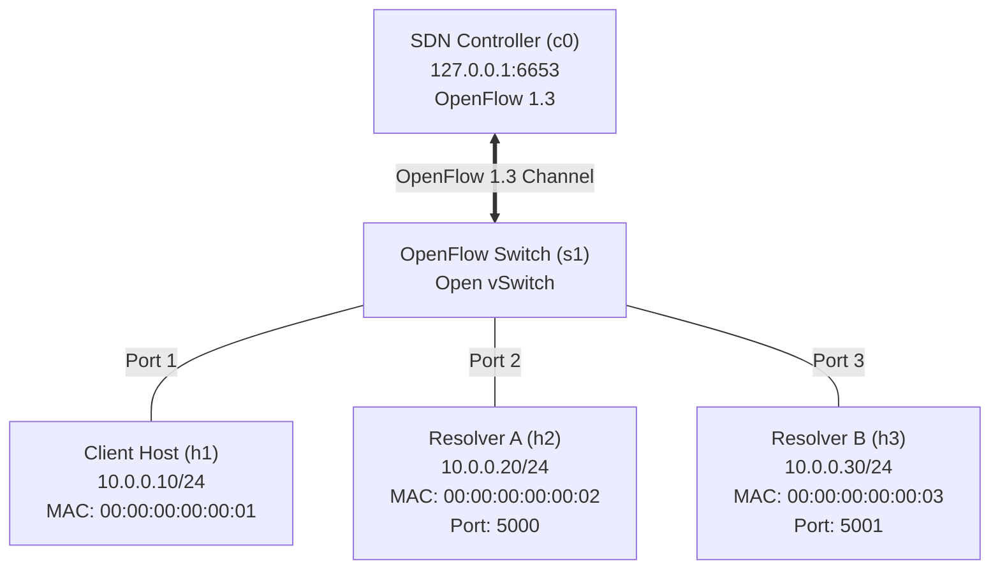
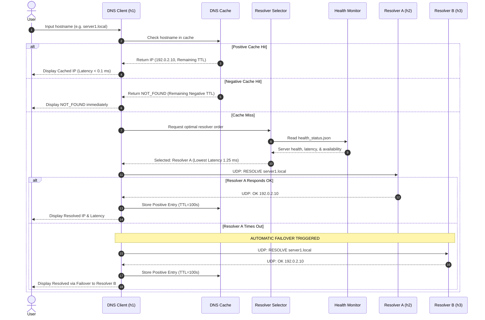
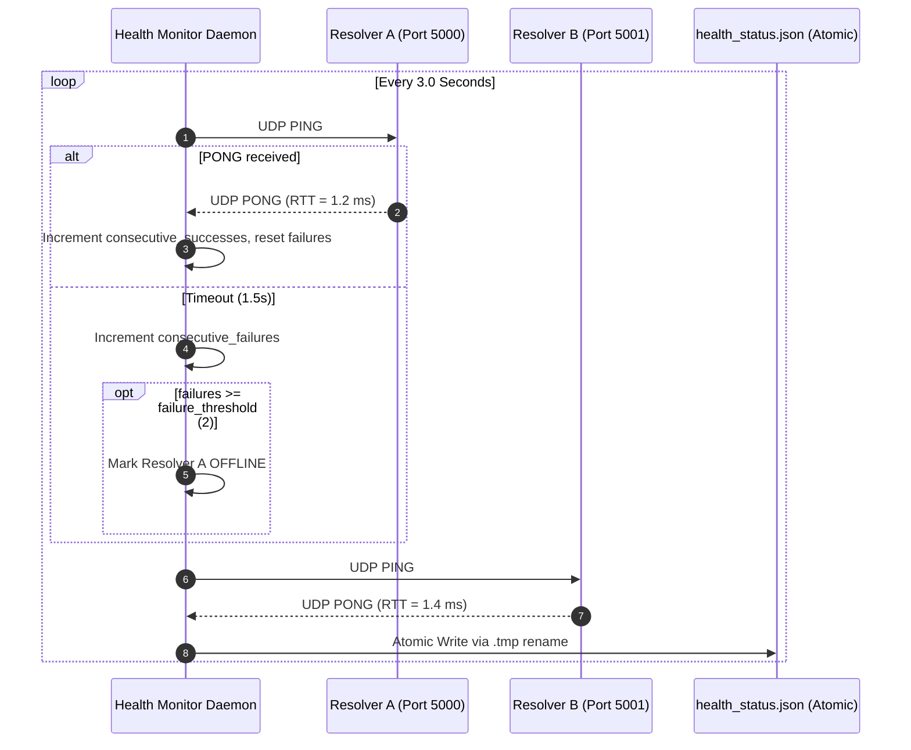
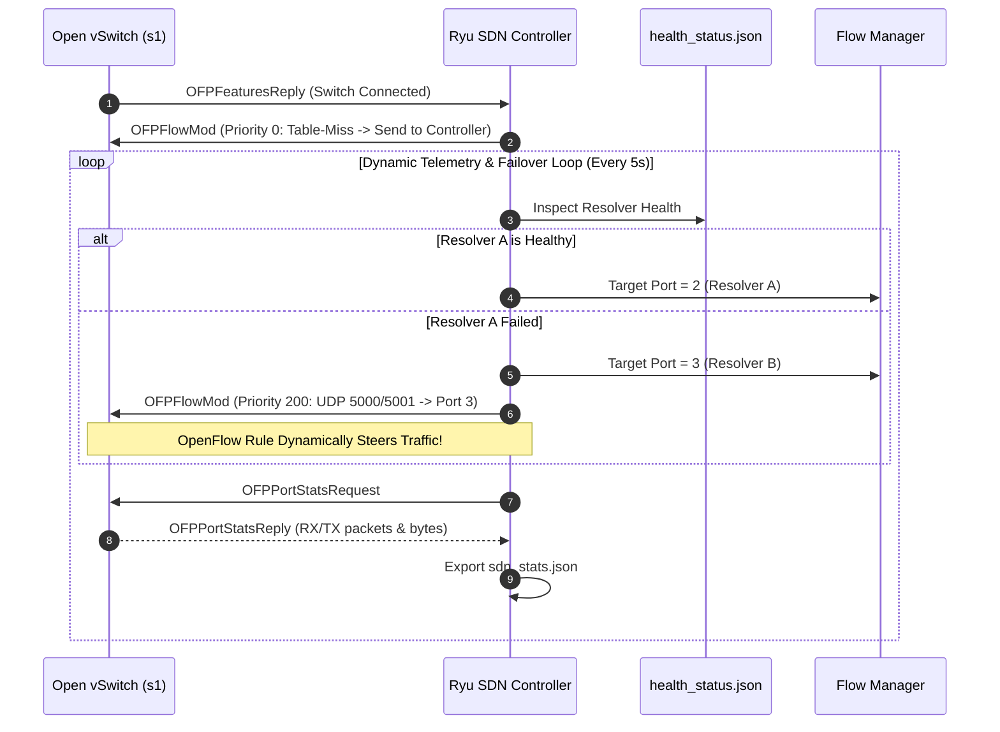

# System Architecture & Technical Design Specification

**Project Title:** DNS-SDN Resolution System: Intelligent DNS-like Resolution with Multiple Resolvers, Dynamic Load Balancing, Fault Tolerance and SDN-Controlled Network Forwarding
**Version:** 2.0.0 (Academic Edition)
**Standard:** OpenFlow 1.3 / IEEE UDP DNS Model

---

## 1. High-Level System Architecture

The DNS-SDN Resolution System combines **Application-Level Intelligence** (client-side positive/negative caching, latency ranking, failover handling) with **Network-Level Programmability** (OpenFlow 1.3 flow table modification, packet inspection, dynamic traffic steering).

```
+-----------------------------------------------------------------------------------+
|                              SDN CONTROL PLANE                                    |
|                                                                                   |
|   +---------------------------------------------------------------------------+   |
|   |             Ryu / OS-Ken OpenFlow 1.3 Controller Engine                   |   |
|   |  - Table-Miss Flow Management        - MAC Learning & L2 Switching        |   |
|   |  - DNS Priority Flow Installation    - Dynamic Failover Redirection       |   |
|   |  - Periodic Port Telemetry Polling   - Live Network Metrics JSON Exporter |   |
|   +---------------------------------------------------------------------------+   |
+------------------------------------------^----------------------------------------+
                                           | OpenFlow 1.3 (TCP Port 6653)
                                           v
+-----------------------------------------------------------------------------------+
|                              SDN DATA PLANE (Mininet)                             |
|                                                                                   |
|                                +-------------------+                              |
|                                |   Open vSwitch    |                              |
|                                |       (s1)        |                              |
|                                +---+-----+-----+---+                              |
|                      Port 1 (eth1) |     |     | Port 3 (eth3)                    |
|                                    |     | Port 2 (eth2)                          |
|             +----------------------+     |     +----------------------+           |
|             |                            |                            |           |
|             v                            v                            v           |
|      +--------------+             +--------------+             +--------------+   |
|      |   Host h1    |             |   Host h2    |             |   Host h3    |   |
|      |  10.0.0.10   |             |  10.0.0.20   |             |  10.0.0.30   |   |
|      | (DNS Client) |             |(Resolver A)  |             |(Resolver B)  |   |
|      | UDP Port Ephem             |UDP Port 5000 |             |UDP Port 5001 |   |
|      +--------------+             +--------------+             +--------------+   |
+-----------------------------------------------------------------------------------+
```

---

## 2. Mininet Network Topology

The network consists of a single Open vSwitch (`s1`) interconnected with three virtual Linux network namespace hosts:



### Addressing Schema

| Node         | Interface       | IP Address         | MAC Address                       | Role                    | Switch Port |
| ------------ | --------------- | ------------------ | --------------------------------- | ----------------------- | ----------- |
| **h1** | `h1-eth0`     | `10.0.0.10/24`   | `00:00:00:00:00:01`             | DNS Resolution Client   | Port 1      |
| **h2** | `h2-eth0`     | `10.0.0.20/24`   | `00:00:00:00:00:02`             | Resolver Server A       | Port 2      |
| **h3** | `h3-eth0`     | `10.0.0.30/24`   | `00:00:00:00:00:03`             | Resolver Server B       | Port 3      |
| **s1** | `s1-eth[1-3]` | None (L2/L3)       | Virtual DPID `0000000000000001` | OpenFlow 1.3 Switch     | -           |
| **c0** | Remote          | `127.0.0.1:6653` | N/A                               | Ryu / OS-Ken Controller | -           |

---

## 3. Communication Workflows

# 3.1 Client Resolution Workflow (with Caching & Load Balancing)



---

### 3.2 Periodic Health Monitoring & Flapping Mitigation



---

### 3.3 SDN Controller Dynamic Forwarding & OpenFlow Flow Pipeline



---

## 4. Fundamental Architectural Distinction

### Application-Level Selection vs. Network-Level SDN Forwarding

In classical networking, name resolution and routing are decoupled. This project demonstrates how Software-Defined Networking integrates them:

1. **Application-Level Selection (Client Tier):**

   - **Layer:** OSI Layer 7 (Application).
   - **Mechanism:** The client socket application actively chooses whether to send a packet to socket `10.0.0.20:5000` or `10.0.0.30:5001`.
   - **Control Variables:** In-memory caching, user-specified balancing policies (`lowest_latency`, `round_robin`), and reading `health_status.json`.
   - **Limitation:** If a client application has no built-in failover, a server outage halts queries entirely.
2. **Network-Level Forwarding (SDN Control & Data Tier):**

   - **Layer:** OSI Layer 2 (Data Link), Layer 3 (Network), and Layer 4 (Transport).
   - **Mechanism:** Open vSwitch inspects incoming packet headers (`eth_type=0x0800`, `ip_proto=17`, `udp_dst=5000/5001`).
   - **Control Variables:** OpenFlow 1.3 match-action tables pushed by the Ryu/OS-Ken controller.
   - **Advantage:** The SDN controller can dynamically rewrite packet destination addresses or redirect forwarding ports directly at switch hardware line rate, providing transparent failover and network-enforced load balancing without modifying end-host application code!
